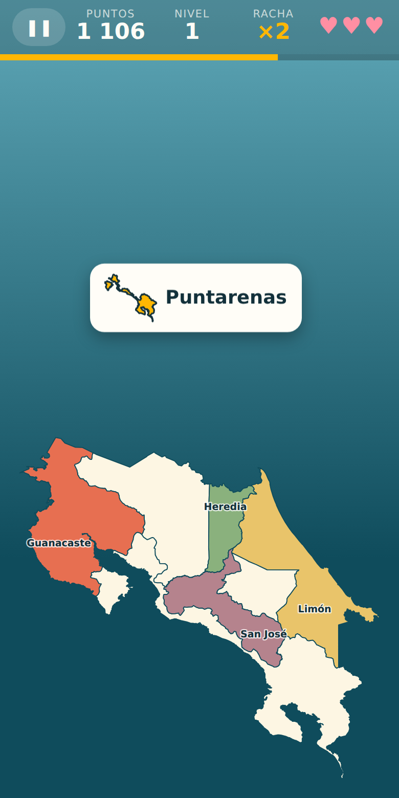
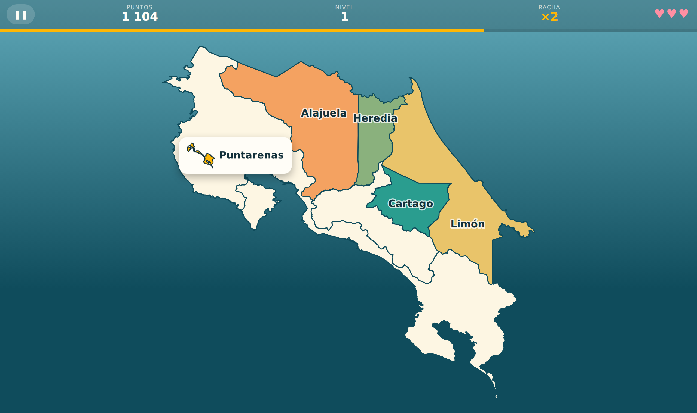

# Mapazo (zip-zap-map-cr)

**A geography game in Spanish for the browser: the provinces of Costa Rica fall from the top of the screen and
you tap where each one belongs on the map before it lands.**

 

## Run

```
./run.sh
```

Then open <http://localhost:8000/>. It is a static site with no build step, so any static host works too.

| Do | Key | Action |
|----|-----|--------|
| Tap or click a province | | Places the falling piece there |
| Tap ❚❚ | `Esc` or `P` | Pause (the map is hidden while paused) |

## How it plays

- Each level is one pass through every region. Level 1 shows name and shape; later levels take one away,
  then speed up.
- A faster answer scores more. Three first-try answers in a row raise the multiplier, up to ×5.
- Three lives. A piece that reaches the ground costs one; a level with no mistakes gives one back.
- The best score per map is kept on the device, and the result can be shared as text.

## Maps

Only *Costa Rica · Provincias* for now. Maps are data files; adding one needs no game code, see
[DEVELOPING.md](DEVELOPING.md).

Boundaries: [geoBoundaries](https://www.geoboundaries.org/), © OpenStreetMap contributors, ODbL.

## Self-test

`./selftest.sh` plays whole games with bots in a headless browser and prints `SELFTEST PASS` or what failed.
It runs on in-memory storage, never on saved records.

## Licence

Code: MIT, see [LICENSE](LICENSE). Map data in `data/` and `packs/`: ODbL, as above.
How it was made: [PROMPT.md](PROMPT.md).
