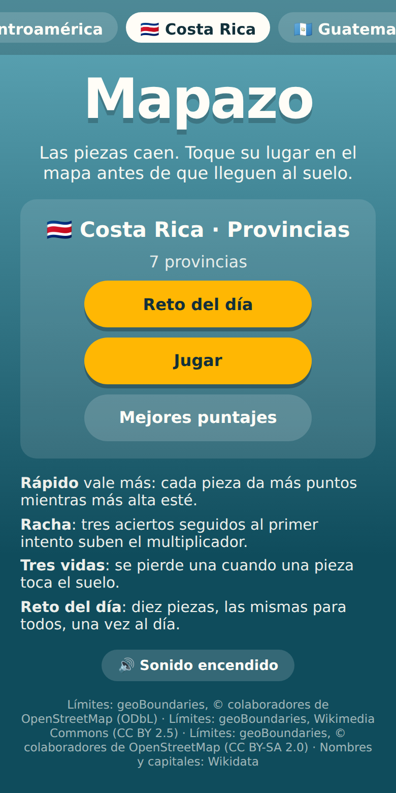
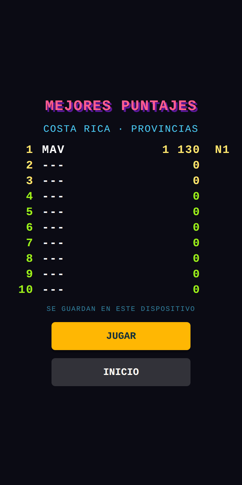

# Ubicatex

**A geography game in Spanish for the browser: continents, oceans, seas, countries and provinces fall from the
top of the screen and you tap where each one belongs on the map before it lands.**

**Play it: [marcelloavila.com/ubicatex](https://marcelloavila.com/ubicatex/)**

  


## Run

```
./run.sh
```

Then open <http://localhost:8000/>. It is a static site with no build step, so any static host works too.

**On a phone on the same Wi-Fi:** once, in Windows, run `tools\lan-open.ps1` as administrator (it prints
the address to open, such as `http://192.168.1.20:8000/`). Run it again after restarting the PC.
`tools\lan-close.ps1` undoes it. Only devices on your home network can connect.

| Do | Key | Action |
|----|-----|--------|
| Tap or click a province | | Places the falling piece there |
| Tap ❚❚ | `Esc` or `P` | Pause (the map is hidden while paused) |

## How it plays

- On the home screen, pick a map from the list, then **Jugar**, **Mapa** (the whole map coloured and named,
  to study; tap a region for its name, and its capital on country maps) or **Mejores puntajes**. The rules
  and the data sources are behind **Cómo jugar** and **Fuentes**.
- Each level is one pass through every region: name and shape, then name only, shape only, capital only
  (★, country maps only), then everything mixed and faster.
- Each right answer fills in its region. At the end of each level the game waits for **Siguiente**, so
  you can look at the map before moving on.
- A faster answer scores more. Three first-try answers in a row raise the multiplier, up to ×5.
- Three lives. A piece that reaches the ground costs one; a level with no mistakes gives one back.
- In levels 1 and 2 a missed piece shows where it belonged. From level 3 it falls again later instead.
- **Top scores.** The best ten per map, with three-letter names, as on an arcade machine, kept on the
  device. No accounts, no server.
- Sound effects and a quiet menu tune, both synthesised; one button turns them off.

## Maps

- The world: continents (America counted as one), oceans, and the main seas and gulfs.
- North, Central and South America by country.
- The provinces or departments of Costa Rica, Guatemala, Belize, El Salvador, Honduras, Nicaragua and Panama.

World maps are best played with the phone sideways. Maps are data files; adding one needs no game code, see
[DEVELOPING.md](DEVELOPING.md). [docs/MAPS.md](docs/MAPS.md) says how tappable each one is on a phone.

Boundaries: [Natural Earth](https://www.naturalearthdata.com/) (public domain) and
[geoBoundaries](https://www.geoboundaries.org/) (© OpenStreetMap contributors, ODbL and CC BY-SA 2.0; Wikimedia
Commons, CC BY 2.5). Names and capitals: [Wikidata](https://www.wikidata.org/) (CC0).

## Self-test

`./selftest.sh` plays whole games with bots in a headless browser and prints `SELFTEST PASS` or what failed.
It runs on in-memory storage, never on saved records.

## Licence

Code: MIT, see [LICENSE](LICENSE). Map data in `data/` and `packs/`: the licences listed under Maps.
How it was made: [PROMPT.md](PROMPT.md).
